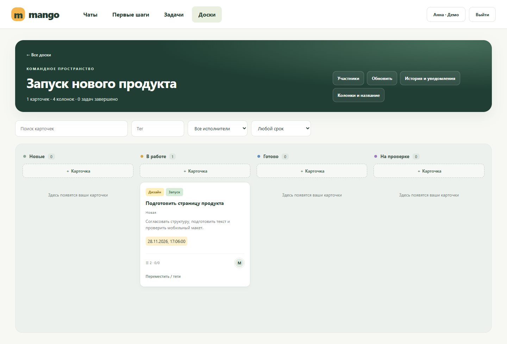
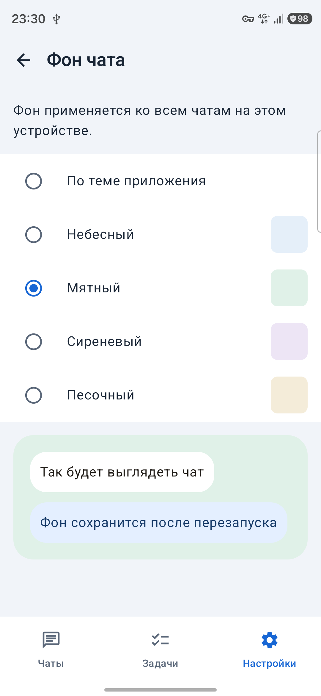
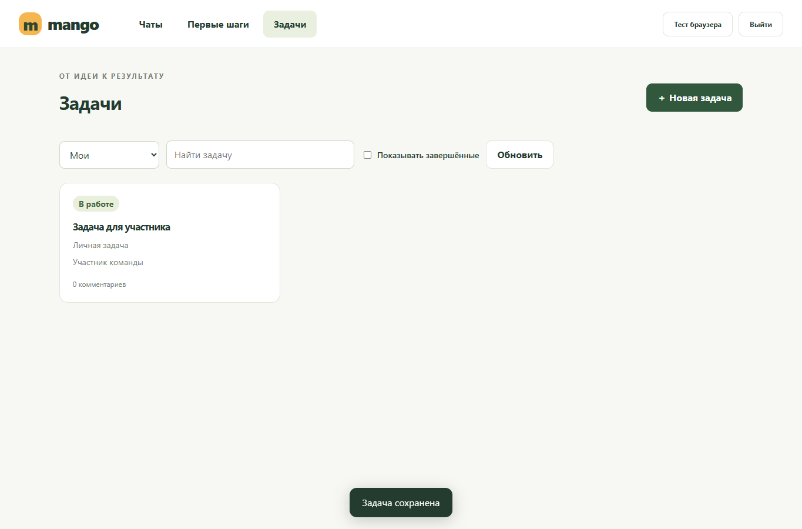
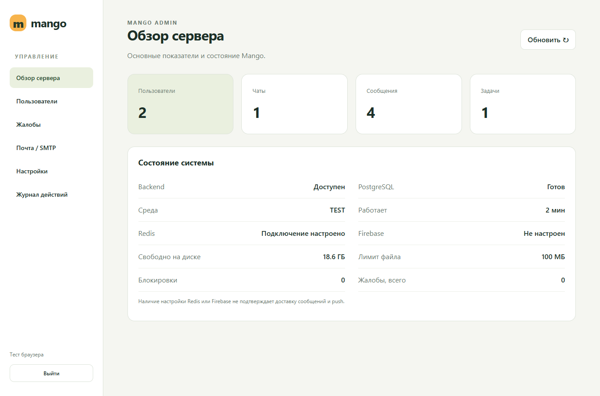

# Mango Messenger

Android-мессенджер с совместными задачами, веб-клиентом и панелью администрирования.
Задачи можно создавать из сообщений, назначать участникам и обсуждать вместе.

**Статус: активная разработка, локальная тестовая версия.** Репозиторий содержит
реализацию приложения и сервера, но не готовую публичную облачную службу.
Все функции бесплатны; Premium задуман как добровольная поддержка проекта.
Внешний ИИ и приём платежей пока не подключены.

Обновления 28 ноября:
- [Длинная история и измерения плавности](docs/ANDROID_PERFORMANCE.md): на Galaxy проверено 450 сообщений онлайн и офлайн; 450 — размер теста, не лимит чата.
- Компактные пузырьки сообщений, группировка по автору, разделители дат и меню действий по удержанию.
- [Создание стикеров с ИИ](docs/IMAGE_AI.md): экран Android и настройки OpenAI в админ-панели. Кнопка скрыта до включения и проверки подключения; реальная генерация без API-ключа ещё не проверена.
- [Резервные копии базы](docs/DATABASE_BACKUPS.md): раздел владельца, создание дампа и восстановление в отдельную базу. Рабочая база автоматически не заменяется; вложения и ключи копируются отдельно.

Добавлены [фотоистории на 24 часа](docs/reports/stories-2026-11-27.md) для контактов
из облачной книги: редактор с текстом и наклейками в Android и вебе. Истории не E2EE;
маски на фото не являются живыми AR-эффектами.

[Приёмка 27 ноября](docs/reports/device-acceptance-2026-11-27.md): на Galaxy проверены
обмен с вебом, офлайн-отправка, push с текстом, ответом и отметкой прочтения.
Восстановление резервной копии проверено отдельно. Два физических Android,
Bluetooth/смешанная mesh, внешний TURN и внешний Kubernetes ещё не приняты.

В Android добавлены [«Люди рядом» и текстовый чат по Bluetooth](docs/NEARBY_AND_BLUETOOTH.md).
Видимость включается при открытии экрана после согласия пользователя. Bluetooth
работает с сопряжённым телефоном, без сервера; проверка радиоканала на двух устройствах
пока не завершена. Ограничения и порядок подключения описаны по ссылке.

Экспериментальный [офлайн-режим Bluetooth + Wi-Fi](docs/OFFLINE_MESH.md) поддерживает
текстовую комнату и пересылку через соседние устройства. Проверена Wi-Fi-ретрансляция
через Galaxy с двумя тестовыми узлами на ноутбуке; смешанный маршрут между физическими
Android-устройствами ещё не проверен. Режим работает при открытом экране комнаты.

Исправлены автовход во встроенную админ-панель и возврат из подразделов настроек.
[Проверка навигации на Galaxy](docs/reports/android-navigation-autologin-2026-11-27.md).

## Kanban MVP

[Описание и соответствие требованиям](docs/KANBAN_SUBMISSION.md) · [Демо-видео рабочего сценария](docs/demo/mango-kanban-demo.webm)



## Скриншоты

Экраны Android сняты на Galaxy 19 ноября 2026 года. Веб-экраны получены
20 ноября 2026 года; задачи и показатели админ-панели используют тестовые данные.
Скриншоты показывают интерфейс соответствующих сборок, а не состояние публичного сервера.

| Чаты Android | Задачи Android | Выбор фона |
|---|---|---|
|  |  |  |

<details>
<summary>Главная страница, веб-задачи и админ-панель</summary>

**Главная страница**


**Задачи в браузере — тестовые данные**



**Админ-панель — тестовые показатели**



</details>

## Возможности

- Регистрация с подтверждением email, вход, восстановление пароля и управление профилем.
- Личные и групповые чаты, поиск, реакции, ссылки, эмоджи и стикеры.
- Вложения и голосовые сообщения; расшифровка через локальный сервис распознавания речи.
- Совместные задачи, исполнители, комментарии, сроки, напоминания, доска статусов и календарь.
- Локальное хранение, очередь исходящих операций и синхронизация после возвращения сети.
- Push через Firebase Cloud Messaging при настройке собственного проекта Firebase.
- Приветственные задачи, фоны чатов, реферальные коды с редактированием.
- Реферальная награда: по 7 дней статуса Premium обоим участникам при выполнении условий.
- Главная страница `/`, веб-клиент `/web/`, панель управления `/admin/`.
- Администрирование пользователей, жалоб, балансов и SMTP; роли владельца, администратора и модератора.
- Скрипты резервного копирования и проверки восстановления.

Перечень описывает реализованные функции, а не гарантию отсутствия ошибок.
Проверки на Galaxy и известные ограничения зафиксированы в [отчётах](docs/reports/).
Веб-клиент не заявляет полного равенства функций с Android.

## Ограничения перед публичным запуском

- Требуются отдельный сервер, публичный домен, HTTPS и рабочий SMTP.
- Текущий Docker Compose предназначен для локального тестирования: Mailpit перехватывает письма,
  Caddy использует собственный удостоверяющий центр. Это не готовая конфигурация публичного сервера.
- Внешний ИИ и платежи требуют провайдеров, аккаунтов и отдельной интеграции.
- Политика конфиденциальности и соглашение остаются черновиками; локальный контакт
  не заменяет действующий публичный адрес поддержки.
- Нужна заключительная проверка обмена между двумя физическими Android-устройствами.
- Манифесты [Kubernetes](infrastructure/kubernetes/) требуют настройки и проверки в целевом кластере.
- **Сквозного шифрования нет:** сервер обрабатывает содержимое сообщений и вложений.
  См. [ADR-0009](docs/adr/0009-no-e2ee-claims.md).

## Стек и требования

Android: Kotlin, Jetpack Compose, Material 3, Hilt, Room, DataStore, Retrofit/OkHttp.
Backend: Kotlin, Ktor, PostgreSQL, Redis, Flyway. Инфраструктура: Docker Compose, Caddy,
локальный сервис распознавания речи. Точные версии находятся в Gradle version catalogs и Docker-файлах.

Для сборки Android нужны JDK 21, Android SDK 37.1 с Build Tools 36.0.0
(targetSdk остаётся 36). Версии закреплены в `android/gradle/libs.versions.toml`.
Для запуска сервера достаточно Git и Docker с Compose v2: JDK внутри образа.
Для команд ниже используется PowerShell. В Android Studio откройте каталог `android`.

## Пошаговая подготовка

### 1. Скачать исходники и проверить инструменты

Установите Git и Docker Desktop, включите Linux containers / WSL 2 и запустите Docker Desktop.
Откройте PowerShell в каталоге, где хотите хранить проект:

```powershell
git clone https://github.com/andrk774/mango-messenger.git
Set-Location mango-messenger
git status --short
docker version
docker compose version
```

| Команда | Что делает |
|---|---|
| `git clone` | Скачивает исходники и историю Git в новый каталог |
| `Set-Location` | Переходит в корень проекта; последующие команды выполняются отсюда |
| `git status --short` | Показывает локальные изменения; пустой вывод означает чистую рабочую копию |
| `docker version` | Проверяет клиент и доступность Docker Engine; должны отображаться Client и Server |
| `docker compose version` | Проверяет наличие Compose v2 |

Если проект уже скачан, перейдите в существующий каталог вместо повторного `clone`.
Если `docker` не найден, проверьте установку и PATH, затем откройте новый PowerShell.

### 2. Подготовить конфигурацию и ключи

Следующая команда копирует шаблон **только если `.env` ещё нет**:

```powershell
if (-not (Test-Path .env)) { Copy-Item .env.example .env }
notepad .env
```

В редакторе задайте уникальные `MANGO_JWT_SECRET` (не менее 32 символов) и
`POSTGRES_PASSWORD`. Для генерации случайного значения без OpenSSL можно использовать:

```powershell
$secretBytes = New-Object byte[] 48
$secretRng = [Security.Cryptography.RandomNumberGenerator]::Create()
try { $secretRng.GetBytes($secretBytes) } finally { $secretRng.Dispose() }
[Convert]::ToBase64String($secretBytes)
```

Команды создают 48 криптографически случайных байт и показывают строку Base64.
Скопируйте результат в `.env`; не отправляйте его в чат или Git. Для пароля базы
сгенерируйте другое значение. На существующей базе изменение `POSTGRES_PASSWORD`
в `.env` само по себе **не меняет пароль PostgreSQL**.

Создайте ключи защиты серверных настроек:

```powershell
if (-not (Test-Path secrets/smtp-encryption.key)) { .\scripts\initialize-smtp-key.ps1 }
.\scripts\initialize-calls-key.ps1
```

Первый скрипт создаёт ключ шифрования SMTP и ограничивает права на файл в Windows.
Второй создаёт ключ настроек звонков, также используемый интеграцией генератора изображений.
Существующие ключи сохраняются. Не заменяйте их при обновлении: старые настройки
должны оставаться расшифровываемыми. Храните защищённую копию вне ноутбука.

| Переменная `.env` | Назначение / локальное значение |
|---|---|
| `MANGO_ENV` | `LOCAL` для локального стенда |
| `MANGO_JWT_SECRET` | Подпись токенов авторизации; собственный секрет |
| `POSTGRES_DB`, `POSTGRES_USER`, `POSTGRES_PASSWORD` | Имя базы, пользователь и пароль |
| `BACKEND_PORT` | HTTP backend на компьютере, по умолчанию `8081` |
| `POSTGRES_PORT`, `REDIS_PORT` | Локальные порты БД и Redis: `5433`, `6380` |
| `MAILPIT_UI_PORT`, `MAILPIT_SMTP_PORT` | Просмотр тестовых писем `8026`, SMTP с компьютера `1026` |
| `MANGO_DOMAIN` | Домен локального HTTPS, по умолчанию `mango.home.arpa` |
| `LAN_HTTPS_PORT` | Порт Caddy для домашней сети, по умолчанию `443` |

Переменные MinIO в шаблоне не означают, что MinIO запускается: текущий Compose
хранит вложения в Docker volume `attachments`.

## Локальный запуск backend

Из корня репозитория, при первой настройке:

```powershell
docker compose --env-file .env -f infrastructure/docker/docker-compose.yml config --quiet
```

`config --quiet` проверяет Compose и подстановку переменных без печати конфигурации
с секретами. При ошибке исправьте `.env` до запуска.

```powershell
docker compose --env-file .env -f infrastructure/docker/docker-compose.yml up -d --build
docker compose --env-file .env -f infrastructure/docker/docker-compose.yml ps
Invoke-RestMethod http://127.0.0.1:8081/v1/health
```

Миграции базы выполняются при запуске backend. Первая сборка требует интернета для зависимостей
и образов; сервис речи также загружает модель.

- `--env-file .env` явно указывает файл переменных из корня проекта.
- `-f ...` выбирает Compose-файл.
- `up -d --build` собирает образы, создаёт сеть и тома, запускает сервисы в фоне.
- `ps` показывает состояние контейнеров и опубликованные порты. Дождитесь здорового backend.
- `Invoke-RestMethod` запрашивает `/v1/health`: успешный ответ подтверждает доступность API,
  но не заменяет проверку входа, push или звонков.

Запускаются PostgreSQL, Redis, Mailpit, backend, сервис речи и Caddy.
Веб-клиент и админ-панель раздаёт backend; отдельный frontend-сервер или `npm start` не нужен.

| Адрес на компьютере | Назначение |
|---|---|
| `http://127.0.0.1:8081/` | Главная страница |
| `http://127.0.0.1:8081/web/` | Веб-клиент |
| `http://127.0.0.1:8081/admin/` | Панель администрирования, требуется соответствующая роль |
| `http://127.0.0.1:8026/` | Mailpit: письма подтверждения и восстановления |

Для Galaxy в домашней сети нужны доступный адрес компьютера и доверие к локальному сертификату.
Инструкции: [локальная сборка и эксплуатация](docs/LOCAL_RELEASE.md),
[экспорт сертификата](scripts/export-local-ca.sh).
`localhost` на телефоне означает сам телефон. VPN может менять маршруты локальной сети.

### Первый вход и назначение владельца

1. Откройте `/web/`, зарегистрируйте аккаунт с собственным username и паролем.
2. Откройте Mailpit по адресу из таблицы, найдите письмо подтверждения и подтвердите email.
   Mailpit принимает письма только на стенде — в настоящий почтовый ящик они не уходят.
3. Войдите в веб-клиент. Для управления сервером назначьте владельца из серверной консоли:

```powershell
docker compose --env-file .env -f infrastructure/docker/docker-compose.yml exec backend /opt/mango/bin/app --bootstrap-owner YOUR_USERNAME
```

Замените `YOUR_USERNAME` на username зарегистрированного пользователя, без `@`.
Команда выдаёт роль `OWNER` подтверждённому, незаблокированному аккаунту и записывает
действие в журнал. Другие владельцы сохраняются; повторное назначение тому же аккаунту
не создаёт нового пользователя. Это привилегированная операция оператора сервера.
После неё откройте `/admin/`; при необходимости обновите сеанс входа.

### Galaxy через домашний Wi-Fi и HTTPS

Backend на `8081` привязан к `127.0.0.1`: напрямую через LAN этот порт недоступен.
Для телефона используется Caddy на `443`. Телефон и компьютер должны быть в одной сети;
брандмауэр должен разрешать входящий TCP 443 для доверенной домашней сети.

```powershell
Get-NetIPConfiguration
docker cp mango-caddy-1:/data/caddy/pki/authorities/local/root.crt secrets/mango-local-ca.crt
```

Первая команда показывает IPv4 активного сетевого адаптера. Вторая копирует **публичный**
корневой сертификат запущенного Caddy для последующей Android-сборки.
Не копируйте приватный ключ центра сертификации. Эквивалент для Bash —
`bash scripts/export-local-ca.sh`.

Соберите APK с `ServerUrl=https://mango.home.arpa/` и `ServerIp`, равным текущему LAN-IP
компьютера (команда ниже). Сборка использует экспортированный сертификат.
Для браузера дополнительно настройте разрешение домена в LAN-IP и доверие к этому CA
на конкретном устройстве. Если домен изменён, проверьте настройки доверия Android.
Обычный публичный HTTPS требует собственного домена и сертификата публичного CA:
текущий Caddyfile использует `tls internal`, одной смены имени домена недостаточно.

## Android: сборка и проверки

Для эмулятора debug по умолчанию использует `http://10.0.2.2:8081/`:

```powershell
$env:JAVA_HOME = 'C:\Program Files\Android\Android Studio\jbr'
$env:ANDROID_HOME = "$env:LOCALAPPDATA\Android\Sdk"
.\android\gradlew.bat -p android :app:assembleDebug
.\android\gradlew.bat -p android testDebugUnitTest lintDebug
```

Адрес меняется параметрами Gradle `-Pmango.serverUrl=...` и, при необходимости,
`-Pmango.serverIp=...`. Для release используйте HTTPS.
APK находятся в `android/app/build/outputs/apk/`.

`JAVA_HOME` выбирает JDK (проверьте, что установлен JDK 21); `ANDROID_HOME` задаёт путь
к SDK. SDK Platform 37.1, Build Tools 36.0.0 и Platform Tools установите через SDK Manager.
`assembleDebug` собирает debug APK, `testDebugUnitTest` запускает модульные тесты,
`lintDebug` выполняет статический анализ. Gradle Wrapper скачивает закреплённую версию
Gradle — устанавливать Gradle отдельно не требуется.

Подписанная локальная release-сборка из корня репозитория:

```powershell
.\scripts\build-release.ps1 -ServerUrl 'https://mango.home.arpa/' -ServerIp '<IP компьютера в LAN>'
```

Скрипт использует Windows DPAPI и при первом запуске создаёт ключ в `secrets/release`.
Сохраните переносимую зашифрованную резервную копию ключа и храните пароль отдельно.
Не заменяйте ключ уже распространяемого приложения: обновления должны сохранять подпись.

Установка release APK на подключённый телефон:

```powershell
$adb = "$env:LOCALAPPDATA\Android\Sdk\platform-tools\adb.exe"
& $adb devices
& $adb install -r android/app/build/outputs/apk/release/app-release.apk
```

`devices` должен показать телефон со статусом `device`. При `unauthorized` подтвердите
USB-отладку на разблокированном телефоне. `install -r` обновляет приложение с сохранением
данных при совместимой подписи. При ошибке подписи используйте исходный ключ сборки;
удаление приложения ради установки уничтожит его локальные данные.

## Обслуживание и обновление сервера

Все команды выполняются из корня проекта. Если стенд запускался с дополнительными
Compose-файлами, добавляйте те же `-f` при обслуживании.

```powershell
docker compose --env-file .env -f infrastructure/docker/docker-compose.yml logs --tail 100 backend
docker compose --env-file .env -f infrastructure/docker/docker-compose.yml logs -f backend
```

Первая команда показывает последние 100 строк backend, вторая следит за новыми строками.
`Ctrl+C` завершает просмотр, сервер продолжает работать. Перед публикацией логов удаляйте
персональные данные и токены.

```powershell
docker compose --env-file .env -f infrastructure/docker/docker-compose.yml stop
docker compose --env-file .env -f infrastructure/docker/docker-compose.yml start
```

`stop` останавливает контейнеры, сохраняя данные, `start` запускает существующие контейнеры.
Выполняйте их по необходимости, а не вместе как обязательный шаг установки.
`restart backend` перезапускает процесс, но не применяет новый образ и изменения окружения.

Обновление чистой рабочей копии после резервного копирования:

```powershell
git status --short
git pull --ff-only
docker compose --env-file .env -f infrastructure/docker/docker-compose.yml up -d --build
docker compose --env-file .env -f infrastructure/docker/docker-compose.yml ps
Invoke-RestMethod http://127.0.0.1:8081/v1/health
```

Если `git status` показывает изменения, сначала сохраните и согласуйте их; не выполняйте
`reset --hard`. `pull --ff-only` получает обновления без автоматического merge-коммита.
`up -d --build` пересобирает исходники и обновляет контейнеры; возможен короткий перерыв.
Не используйте `down -v` для обновления: он удаляет тома с данными.

## Резервная копия и проверка восстановления

В панели владельца: **Настройки → Резервные копии**. Копия БД и проверка восстановления
описаны в [DATABASE_BACKUPS.md](docs/DATABASE_BACKUPS.md).
Проверка создаёт отдельную базу и не подменяет рабочую. Копии внутри Docker volume
не защищают от потери диска — нужен перенос на отдельный носитель.

Для копии БД вместе с вложениями из PowerShell (Docker должен быть доступен в PATH):

```powershell
.\scripts\backup-local.ps1
.\scripts\verify-backup.ps1 -BackupDirectory 'C:\path\to\mango-messenger\artifacts\backups\YOUR_BACKUP'
```

`backup-local.ps1` создаёт дамп PostgreSQL, копирует вложения и записывает контрольные суммы
в `artifacts/backups/<идентификатор>`. Подставьте фактически созданный каталог во вторую
команду. `verify-backup.ps1` проверяет суммы и разворачивает дамп в отдельную тестовую БД;
тестовая база остаётся для проверки. Для согласованной копии БД и файлов заранее прекратите
запись пользователей на время копирования. Скрипты рассчитаны на стандартные имена
контейнеров/БД; при изменённых настройках передайте их параметры.

Отдельно сохраните `.env`, `secrets/` (включая ключи SMTP, звонков и подписи), конфигурацию
развёртывания и данные локального CA в защищённом архиве. Дамп БД содержит настройки SMTP,
но для чтения зашифрованных полей нужен прежний ключ. Эти файлы не публикуются в GitHub.
Замена действующей БД требует отдельного плана остановки, восстановления и отката.

## Если запуск не удался

| Симптом | Что проверить |
|---|---|
| Нет связи с Docker Engine | Docker Desktop запущен, выбран Linux backend, WSL работает |
| Compose требует JWT secret | `.env` создан и команда выполняется из корня с `--env-file .env` |
| Порт занят | Освободите порт или измените соответствующую переменную `.env`, затем выполните `up -d` |
| Backend `unhealthy` | `logs --tail 100 backend`, состояние PostgreSQL/Redis, пароль существующей БД |
| Нет письма | Для LOCAL откройте Mailpit, проверьте логи backend; внешняя доставка требует рабочего SMTP |
| Телефон не подключается | Wi-Fi, LAN-IP, DNS, порт 443, сертификат, правила VPN и брандмауэра |
| Изменения сайта не видны | Пересоберите backend через `up -d --build`, обновите страницу без кеша |
| APK не собирается | JDK, SDK 37.1, лицензии SDK и доступ к репозиториям зависимостей |

## Дополнительные сервисы и внешний сервер

Обычный запуск выше не требует Kubernetes. Настройка целевого кластера описана в
[инструкции Kubernetes](infrastructure/kubernetes/README.md), подключение API —
[KUBERNETES_API.md](docs/KUBERNETES_API.md). Не применяйте манифесты к случайному контексту.

Звонки требуют отдельной настройки [LiveKit/TURN](docs/CALLS.md), генерация изображений —
[провайдера ИИ](docs/IMAGE_AI.md), push — Firebase (ниже).
Для внешнего размещения нужны сервер, домен, публичный HTTPS/WSS и рабочий SMTP.
Локальные Mailpit и сертификат Caddy не заменяют эти сервисы.

## Backend: тесты

Из корня, при запущенном Docker (интеграционные тесты используют Testcontainers):

```powershell
.\backend\gradlew.bat -p backend test
```

Результаты тестов находятся в каталогах `build/reports/tests` соответствующих модулей.
Числа в старых отчётах относятся к конкретным проверкам, а не к текущему состоянию ветки.
Подготовка README и аудит секретов сами по себе не означают повторный прогон всех тестов.

## Push, SMTP и секреты

Для push настройте собственный Firebase-проект:

- Android-конфигурация: `android/app/google-services.json`.
- Серверный ключ: `secrets/firebase-service-account.json`.

Без этих файлов push не настроены; локальная синхронизация остаётся отдельным механизмом.
SMTP настраивается окружением и средствами панели администрирования; для локального теста
используется Mailpit. При переносе сохраните ключ шифрования настроек SMTP вместе с защищённой
резервной копией, отдельно от публичных исходников.

Не публикуйте `.env`, `secrets/`, ключи подписи, дампы баз, резервные копии,
логи с токенами, пользовательские вложения и снимки экранов с личными данными.
Каталог `artifacts/` предназначен для локальных результатов и исключён из Git.
Подробнее: [проверка перед публикацией](docs/reports/github-prepublication-2026-11-19.md).

## Структура

| Каталог | Содержимое |
|---|---|
| `android/` | Приложение и модули клиента |
| `backend/` | API, бизнес-логика, миграции, веб-клиент и панель управления |
| `infrastructure/` | Docker, Kubernetes и сервис речи |
| `scripts/` | Сборка, резервное копирование и проверки |
| `docs/` | Архитектура, API, решения и отчёты |

## Документация

- [Архитектура](docs/architecture/overview.md) и [синхронизация](docs/architecture/sync-model.md).
- [API](docs/api/openapi.yaml) — сверяйте с маршрутами сервера при разработке новых интеграций.
- [Веб-клиент и администрирование](docs/WEB_ADMIN.md).
- [Приветственные задачи](docs/WELCOME_TASKS.md).
- [Premium, приглашения и фоны](docs/reports/premium-referrals-background-2026-11-19.md).
- [Профиль и настройки](docs/reports/profile-settings-2026-11-19.md).

## Лицензия

Код Mango Messenger распространяется под открытой лицензией [MIT](LICENSE).
Copyright (c) 2026 andrk774.

Разрешены использование, изменение и распространение, включая коммерческое,
при сохранении уведомления об авторстве и текста лицензии. Программное обеспечение
предоставляется без гарантий. Сторонние зависимости и материалы сохраняют свои лицензии.
