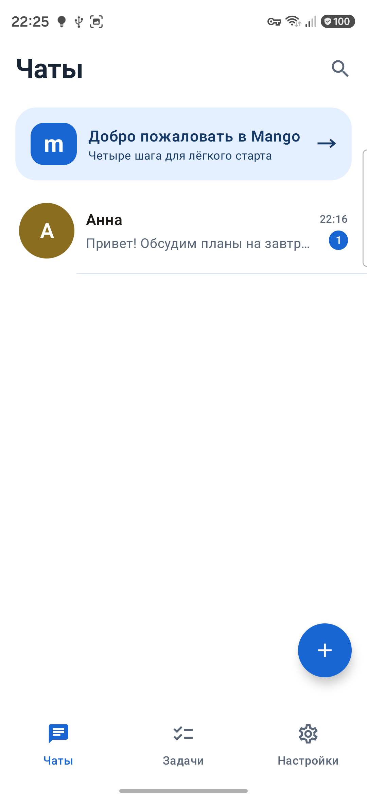
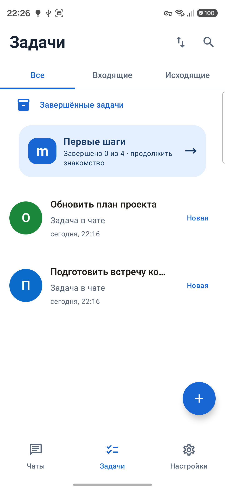
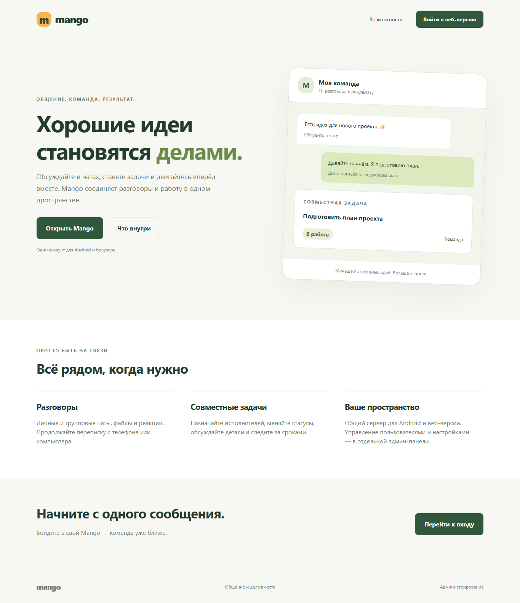

# Mango Messenger

Android-мессенджер с совместными задачами, веб-клиентом и панелью администрирования.
Задачи можно создавать из сообщений, назначать участникам и обсуждать вместе.

**Статус: активная разработка, локальная тестовая версия.** Репозиторий содержит
реализацию приложения и сервера, но не готовую публичную облачную службу.
Все функции бесплатны; Premium задуман как добровольная поддержка проекта.
Внешний ИИ и приём платежей пока не подключены.

Добавлены [фотоистории на 24 часа](docs/reports/stories-2026-11-27.md) для контактов
из облачной книги: редактор с текстом и наклейками в Android и вебе. Истории не E2EE;
маски на фото не являются живыми AR-эффектами.

[Приёмка 27 ноября](docs/reports/device-acceptance-2026-11-27.md): на Galaxy проверены
обмен с вебом, офлайн-отправка, push с текстом, ответом и отметкой прочтения.
Восстановление резервной копии проверено отдельно. Два физических Android,
Bluetooth/смешанная mesh, внешний TURN и внешний Kubernetes ещё не приняты.

В Android добавлены [«Люди рядом» и текстовый чат по Bluetooth](docs/NEARBY_AND_BLUETOOTH.md).
Видимость включается при открытии экрана после согласия пользователя. Bluetooth
работает с сопряжённым телефоном, без сервера; проверка радиоканала на двух устройствах
пока не завершена. Ограничения и порядок подключения описаны по ссылке.

Экспериментальный [офлайн-режим Bluetooth + Wi-Fi](docs/OFFLINE_MESH.md) поддерживает
текстовую комнату и пересылку через соседние устройства. Проверена Wi-Fi-ретрансляция
через Galaxy с двумя тестовыми узлами на ноутбуке; смешанный маршрут между физическими
Android-устройствами ещё не проверен. Режим работает при открытом экране комнаты.

Исправлены автовход во встроенную админ-панель и возврат из подразделов настроек.
[Проверка навигации на Galaxy](docs/reports/android-navigation-autologin-2026-11-27.md).

## Kanban MVP

[Описание и соответствие требованиям](docs/KANBAN_SUBMISSION.md) · [Демо-видео рабочего сценария](docs/demo/mango-kanban-demo.webm)


## Скриншоты

Экраны Android сняты на Galaxy 19 ноября 2026 года. Веб-экраны получены
20 ноября 2026 года; задачи и показатели админ-панели используют тестовые данные.
Скриншоты показывают интерфейс соответствующих сборок, а не состояние публичного сервера.

| Чаты Android | Задачи Android | Выбор фона |
|---|---|---|
|  |  |  |

<details>
<summary>Главная страница, веб-задачи и админ-панель</summary>

**Главная страница**



**Задачи в браузере — тестовые данные**


**Админ-панель — тестовые показатели**


</details>

## Возможности

- Регистрация с подтверждением email, вход, восстановление пароля и управление профилем.
- Личные и групповые чаты, поиск, реакции, ссылки, эмоджи и стикеры.
- Вложения и голосовые сообщения; расшифровка через локальный сервис распознавания речи.
- Совместные задачи, исполнители, комментарии, сроки, напоминания, доска статусов и календарь.
- Локальное хранение, очередь исходящих операций и синхронизация после возвращения сети.
- Push через Firebase Cloud Messaging при настройке собственного проекта Firebase.
- Приветственные задачи, фоны чатов, реферальные коды с редактированием.
- Реферальная награда: по 7 дней статуса Premium обоим участникам при выполнении условий.
- Главная страница `/`, веб-клиент `/web/`, панель управления `/admin/`.
- Администрирование пользователей, жалоб, балансов и SMTP; роли владельца, администратора и модератора.
- Скрипты резервного копирования и проверки восстановления.

Перечень описывает реализованные функции, а не гарантию отсутствия ошибок.
Проверки на Galaxy и известные ограничения зафиксированы в [отчётах](docs/reports/).
Веб-клиент не заявляет полного равенства функций с Android.

## Ограничения перед публичным запуском

- Требуются отдельный сервер, публичный домен, HTTPS и рабочий SMTP.
- Текущий Docker Compose предназначен для локального тестирования: Mailpit перехватывает письма,
  Caddy использует собственный удостоверяющий центр. Это не готовая конфигурация публичного сервера.
- Внешний ИИ и платежи требуют провайдеров, аккаунтов и отдельной интеграции.
- Политика конфиденциальности и соглашение остаются черновиками; локальный контакт
  не заменяет действующий публичный адрес поддержки.
- Нужна заключительная проверка обмена между двумя физическими Android-устройствами.
- Манифесты [Kubernetes](infrastructure/kubernetes/) требуют настройки и проверки в целевом кластере.
- **Сквозного шифрования нет:** сервер обрабатывает содержимое сообщений и вложений.
  См. [ADR-0009](docs/adr/0009-no-e2ee-claims.md).

## Стек и требования

Android: Kotlin, Jetpack Compose, Material 3, Hilt, Room, DataStore, Retrofit/OkHttp.
Backend: Kotlin, Ktor, PostgreSQL, Redis, Flyway. Инфраструктура: Docker Compose, Caddy,
локальный сервис распознавания речи. Точные версии находятся в Gradle version catalogs и Docker-файлах.

Для разработки нужны JDK 21, Android SDK 36 с Build Tools 36.0.0 и Docker с Compose.
Для команд ниже используется PowerShell. В Android Studio откройте каталог `android`.

## Локальный запуск backend

Из корня репозитория, при первой настройке:

```powershell
Copy-Item .env.example .env
```

Не перезаписывайте существующий `.env`. Укажите собственный случайный `MANGO_JWT_SECRET`
и пароль базы. Значения в `.env.example` предназначены только для примера.
При необходимости сгенерируйте секрет локально: `openssl rand -base64 48`.
Секреты не добавляйте в Git.

```powershell
docker compose --env-file .env -f infrastructure/docker/docker-compose.yml up -d --build
docker compose --env-file .env -f infrastructure/docker/docker-compose.yml ps
Invoke-RestMethod http://127.0.0.1:8081/v1/health
```

Миграции базы выполняются при запуске backend. Первая сборка требует интернета для зависимостей
и образов; сервис речи также загружает модель.

| Адрес на компьютере | Назначение |
|---|---|
| `http://127.0.0.1:8081/` | Главная страница |
| `http://127.0.0.1:8081/web/` | Веб-клиент |
| `http://127.0.0.1:8081/admin/` | Панель администрирования, требуется соответствующая роль |
| `http://127.0.0.1:8026/` | Mailpit: письма подтверждения и восстановления |

Для Galaxy в домашней сети нужны доступный адрес компьютера и доверие к локальному сертификату.
Инструкции: [локальная сборка и эксплуатация](docs/LOCAL_RELEASE.md),
[экспорт сертификата](scripts/export-local-ca.sh).
`localhost` на телефоне означает сам телефон. VPN может менять маршруты локальной сети.

## Android: сборка и проверки

Для эмулятора debug по умолчанию использует `http://10.0.2.2:8081/`:

```powershell
cd android
.\gradlew.bat :app:assembleDebug
.\gradlew.bat testDebugUnitTest lintDebug
```

Адрес меняется параметрами Gradle `-Pmango.serverUrl=...` и, при необходимости,
`-Pmango.serverIp=...`. Для release используйте HTTPS.
APK находятся в `android/app/build/outputs/apk/`.

Подписанная локальная release-сборка из корня репозитория:

```powershell
.\scripts\build-release.ps1 -ServerUrl 'https://mango.home.arpa/' -ServerIp '<IP компьютера в LAN>'
```

Скрипт использует Windows DPAPI и при первом запуске создаёт ключ в `secrets/release`.
Сохраните переносимую зашифрованную резервную копию ключа и храните пароль отдельно.
Не заменяйте ключ уже распространяемого приложения: обновления должны сохранять подпись.

## Backend: тесты

Из корня, при запущенном Docker (интеграционные тесты используют Testcontainers):

```powershell
.\backend\gradlew.bat -p backend test
```

Результаты тестов находятся в каталогах `build/reports/tests` соответствующих модулей.
Числа в старых отчётах относятся к конкретным проверкам, а не к текущему состоянию ветки.
Подготовка README и аудит секретов сами по себе не означают повторный прогон всех тестов.

## Push, SMTP и секреты

Для push настройте собственный Firebase-проект:

- Android-конфигурация: `android/app/google-services.json`.
- Серверный ключ: `secrets/firebase-service-account.json`.

Без этих файлов push не настроены; локальная синхронизация остаётся отдельным механизмом.
SMTP настраивается окружением и средствами панели администрирования; для локального теста
используется Mailpit. При переносе сохраните ключ шифрования настроек SMTP вместе с защищённой
резервной копией, отдельно от публичных исходников.

Не публикуйте `.env`, `secrets/`, ключи подписи, дампы баз, резервные копии,
логи с токенами, пользовательские вложения и снимки экранов с личными данными.
Каталог `artifacts/` предназначен для локальных результатов и исключён из Git.
Подробнее: [проверка перед публикацией](docs/reports/github-prepublication-2026-11-19.md).

## Структура

| Каталог | Содержимое |
|---|---|
| `android/` | Приложение и модули клиента |
| `backend/` | API, бизнес-логика, миграции, веб-клиент и панель управления |
| `infrastructure/` | Docker, Kubernetes и сервис речи |
| `scripts/` | Сборка, резервное копирование и проверки |
| `docs/` | Архитектура, API, решения и отчёты |

## Документация

- [Архитектура](docs/architecture/overview.md) и [синхронизация](docs/architecture/sync-model.md).
- [API](docs/api/openapi.yaml) — сверяйте с маршрутами сервера при разработке новых интеграций.
- [Веб-клиент и администрирование](docs/WEB_ADMIN.md).
- [Приветственные задачи](docs/WELCOME_TASKS.md).
- [Premium, приглашения и фоны](docs/reports/premium-referrals-background-2026-11-19.md).
- [Профиль и настройки](docs/reports/profile-settings-2026-11-19.md).

## Лицензия

Код Mango Messenger распространяется под открытой лицензией [MIT](LICENSE).
Copyright (c) 2026 andrk774.

Разрешены использование, изменение и распространение, включая коммерческое,
при сохранении уведомления об авторстве и текста лицензии. Программное обеспечение
предоставляется без гарантий. Сторонние зависимости и материалы сохраняют свои лицензии.
