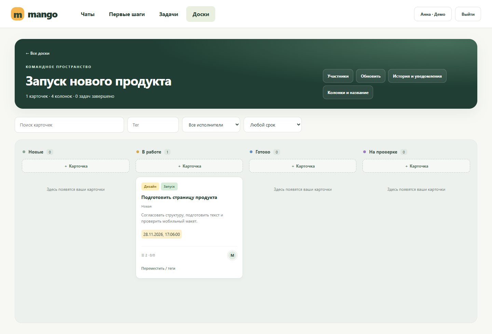
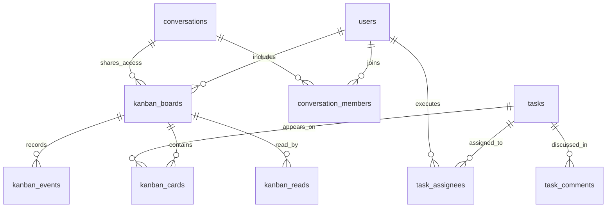

# Mango Kanban — материалы для сдачи

## Результат

- [Исходники проекта, ветка Kanban MVP](https://github.com/andrk774/mango-messenger/tree/feature/kanban-mvp).
- [Демо-видео рабочего сценария (WebM)](demo/mango-kanban-demo.webm).
- [Описание API, ограничений и правил доступа](KANBAN.md).



Видео записано с настоящим локальным backend и PostgreSQL, без подмены API. Использованы два специально созданных демонстрационных аккаунта. Второй участник отвечает через API; ответ виден в интерфейсе первого участника. Видео без озвучки. Оно показывает вход, создание командной доски, участников, описание задачи, назначение исполнителя, срок, комментарии двух пользователей, перенос карточки, теги, новую колонку, фильтр и историю.

## Соответствие MVP

| Требование | Реализация |
|---|---|
| Регистрация / вход | Email, подтверждение письмом, пароль, сессии Mango |
| Владелец и участники | Владелец доски; участники наследуются от выбранного чата. Личная доска доступна только владельцу |
| Создание / редактирование / удаление досок | Список «Доски», форма создания, «Колонки и название», подтверждение удаления |
| Колонки | Создание, переименование, изменение порядка; заполненную колонку нельзя удалить |
| Карточки | Общие задачи Mango: заголовок, описание, исполнители, дедлайн, комментарии |
| Перемещение и порядок | Drag-and-drop и меню с выбором колонки и позиции |
| Удаление доски | Мягкое удаление; задачи и комментарии сохраняются |

Управление участниками общей доски меняет состав связанного чата и всех его досок. В интерфейсе есть предупреждение об этом. Добавление/исключение доступно владельцу или администратору группового чата. Изменять структуру и удалять доску может только её владелец с действующим доступом.

## Дополнительные возможности

Реализованы теги, фильтры, поиск, история изменений, счётчик непрочитанных изменений. Сервер хранит версии досок и отклоняет устаревшие изменения с HTTP 409. Веб-клиент периодически проверяет новые версии и предлагает обновление.

Не входят в эту версию: чек-лист внутри карточки, прямые вложения в карточку, шаблоны досок и доставка событий доски через WebSocket. Обновление досок использует HTTP polling, а не WebSocket. Мессенджер имеет свои возможности вложений и синхронизации, но они не объявляются реализованными расширениями Kanban.

## Архитектура и технологии

Frontend — существующий веб-клиент Mango на JavaScript, HTML и CSS; логика досок выделена в `kanban.js`, дизайн — в `kanban.css`. Дополнительный UI-фреймворк не вводился: используются уже работающие авторизация, формы, карточки задач и диалоги. Backend — Kotlin/Ktor, PostgreSQL, SQL через JDBC, миграции Flyway. Это осознанное использование существующего приложения, а не отдельный новый React-проект.

Модель интерфейса сопоставлена с [официальным описанием досок Trello](https://support.atlassian.com/trello/docs/creating-a-new-board/) и [фильтрами по меткам, участникам и срокам](https://support.atlassian.com/trello/docs/single-board-table-view/).



Колонки — упорядоченный JSONB-массив внутри строки доски; размещения карточек и связи с задачами — отдельная таблица. Существование целевой колонки и её непустоту при удалении проверяет сервер под блокировкой строки доски. Изменение и запись аудита выполняются в одной транзакции. Позиция на доске и статус общей задачи независимы: одна задача может присутствовать на нескольких досках.

## Запуск и проверка

Используйте инструкции локального запуска из корневого README. После старта сервера откройте `/web/`, зарегистрируйте аккаунты, подтвердите email через локальный Mailpit, создайте групповой чат и выберите его при создании доски.

Для проверок backend нужны JDK 21 и запущенный Docker. Тесты используют отдельный PostgreSQL Testcontainers:

```powershell
./backend/gradlew.bat -p backend :app:test --tests '*KanbanIntegrationTest' --tests '*TasksIntegrationTest'
```

Браузерные сценарии с тестовыми API:

```powershell
node scripts/test-web-ui.cjs <путь-к-модулю-playwright>
```

Повторная запись видео на локальном сервере (создаёт два новых демо-аккаунта и сохраняет их данные):

```powershell
node scripts/record-kanban-demo.cjs <путь-к-модулю-playwright>
```

Скрипт использует localhost:8081, Mailpit localhost:8026 и Chrome; `MANGO_DEMO_BASE_URL` и `CHROME_PATH` задают другие адрес и браузер. Пароли генерируются в памяти и не записываются в отчёт. Результат — `artifacts/kanban-demo/result.json`, скриншот и WebM.

Проверено 25 ноября 2026: 24 backend-теста, браузерные сценарии desktop/mobile, живой сценарий с двумя аккаунтами. Отдельно проверено, что чужой пользователь не видит доску, исключённый участник теряет доступ, личная задача не попадает на общую доску, конфликт версий не затирает изменения, а удаление доски сохраняет задачу.

Это локальный демонстрационный проект. Публичный сервер не развёрнут, E2EE досок отсутствует. Аудит безопасности и эксплуатационная готовность всего Mango — отдельная работа.
