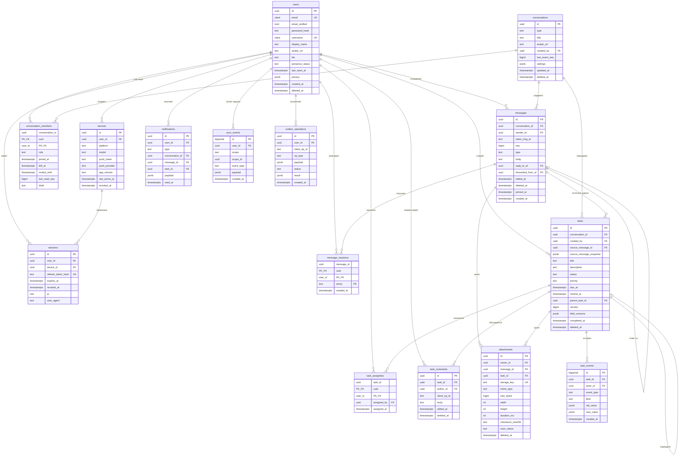

# Модель данных Mango Messenger

Серверная схема (PostgreSQL) и её клиентское зеркало (Room). Расхождения
между ними перечислены в разделе 4 — они намеренные.

---

## 1. ER-диаграмма

---

## 2. Ключевые ограничения целостности

Эти индексы — не оптимизация, а механизм корректности. Они обеспечивают
инварианты, которые нельзя доверить только коду.

| Ограничение | Зачем |
|---|---|
| `UNIQUE (conversation_id, sender_id, client_msg_id)` | Защита от дубликатов при повторной отправке. Последний рубеж, если идемпотентность на уровне HTTP дала сбой |
| `UNIQUE (conversation_id, seq)` | Порядок внутри чата однозначен |
| `UNIQUE (user_id, client_op_id)` в `outbox_operations` | Серверная идемпотентность: повтор возвращает сохранённый результат |
| `UNIQUE (task_id, author_id, client_op_id)` | Комментарий не дублируется при повторе |
| `UNIQUE (refresh_token_hash)` | Ротация refresh token, обнаружение повторного использования |
| `UNIQUE (push_provider, push_token)` где токен не NULL | Один токен не привязан к двум устройствам |
| `UNIQUE` по нормализованной паре участников для `DIRECT` | Повторное открытие переписки не создаёт второй личный чат |
| `CHECK` на `type`, `status`, `priority`, `role` | Невалидное значение не попадёт в БД даже при ошибке в коде |

---

## 3. Индексы для запросов

| Таблица | Индекс | Запрос |
|---|---|---|
| `messages` | `(conversation_id, seq DESC)` | пагинация истории |
| `messages` | `GIN(to_tsvector(body))` | полнотекстовый поиск |
| `conversation_members` | `(user_id) WHERE left_at IS NULL` | список чатов пользователя |
| `tasks` | `(conversation_id, status)` | Kanban по чату |
| `tasks` | `(due_at) WHERE deleted_at IS NULL` | календарь и напоминания |
| `tasks` | `(source_message_id)` | пометка источника при удалении сообщения |
| `task_events` | `(task_id, id)` | история изменений |
| `sync_events` | `(user_id, id)` | догонка по курсору |
| `notifications` | `(user_id, created_at DESC) WHERE read_at IS NULL` | счётчик непрочитанных |

---

## 4. Клиентская схема: намеренные отличия

Room-схема (версия 1, 14 таблиц) зеркалит серверную, но отличается в
нескольких местах — это осознанные решения.

| Отличие | Причина |
|---|---|
| Нет таблиц `sessions`, `devices` | Клиент хранит только свою пару токенов, зашифрованную в Keystore |
| Добавлена `outbox_operations` с полями `attempt_count`, `next_attempt_at`, `depends_on_op_id`, `status` | Это локальная очередь с расписанием повторов, а не серверный журнал идемпотентности |
| Добавлена `sync_state` | Курсоры догонки; лежат в БД, чтобы продвигаться в одной транзакции с событиями |
| Добавлена `message_gaps` | Явный учёт разрывов истории для точечной догрузки |
| `messages.seq` допускает `NULL` | Сообщение, ещё не подтверждённое сервером |
| Добавлено `sync_status` в `messages`, `tasks`, `attachments`, `task_comments` | Состояние доставки видно пользователю |
| Снапшот источника задачи разложен по колонкам, а не в JSON | Поля читаются при отрисовке каждой карточки; разбор JSON на каждый элемент списка не нужен |
| Время — `INTEGER` (epoch millis), не ISO-строка | Сравнение и сортировка идут по индексу |
| Enum хранятся строками, не `ordinal` | Добавление значения в середину перечисления не портит существующие записи |

### Экспорт схемы

`exportSchema = true`, схема версии 1 лежит в
`android/core/database/schemas/com.mango.core.database.MangoDatabase/1.json`.
Без экспортированной схемы невозможен тест миграции, а значит невозможно
безопасно менять схему в уже установленном приложении.

Деструктивные миграции **не включены**: локальная база может содержать
неотправленные сообщения и задачи, и их потеря при обновлении недопустима.

---

## 5. Состояние

| Часть | Статус |
|---|---|
| Клиентская схема Room (14 таблиц, 6 DAO) | ✅ реализована, покрыта 23 тестами |
| Экспорт схемы версии 1 | ✅ |
| Серверная схема PostgreSQL | ⏳ Этап 3 (миграции Flyway) |
| Тест миграции Room | ⏳ появится вместе со второй версией схемы |
